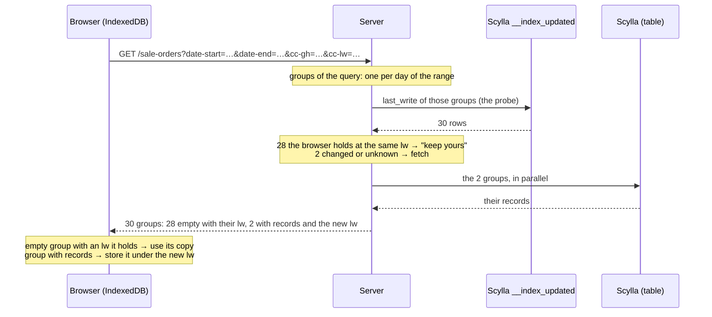
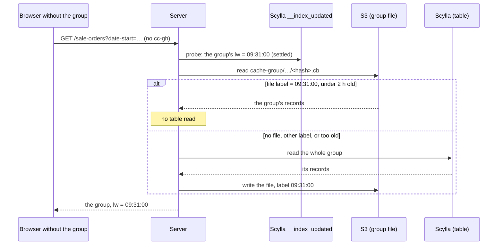

# Cache groups, explained

How a browser keeps the results of a **date-range report** (sales of the last 30 days, sales of one
client, purchases by status…) without downloading every record again each time the report is
opened. It also covers the S3 variant, where the server keeps the groups too. Written for people,
not for the compiler. The precise specification lives in the code: `scylla/index_groups.go`,
`scylla/select_grouped.go`, `scylla/cache_group_snapshot.go`, `db/cache/record_snapshot.go`, and
genix-ui's `cache/group-cache.fetch.ts` / `group-cache.idb.ts`.

The delta cache (`DELTA_CACHE.USER.md`) solves a different problem: one long list kept in sync.
Cache groups suit queries over a **range**, where each value of the range is its own small bucket.

---

## 1. The idea in one paragraph

The table's records are split into **groups**: every record belongs to the group of its key values,
for example "sales of 2026-10-03" or "sales of 2026-10-03 for client 42". Each group carries one
number, its **last write**: when something in it last changed. The browser stores each group it has
received with that number. On the next query it sends the numbers it holds, and the server answers
**only the groups whose number changed**; the others come back empty, meaning "keep yours".

```
 First time the report opens            Next time (one sale added today)
 ───────────────────────────            ────────────────────────────────
 browser: "I hold nothing"              browser: "I hold 30 days, labels …"
 server:  30 days, all their sales      server:  today's group (changed), 29 "keep yours"
```

---

## 2. Words used below

| Word | Meaning |
|---|---|
| **Group** | All the records with the same values of an index's Keys, inside one company (partition). `Keys: Date` → one group per day. `Keys: Date, ClientID` → one group per (day, client). |
| **Group hash** (`id`) | The int32 that names a group: a hash of its key values. |
| `igVal` | The group's key values themselves, so the browser can tell groups apart. |
| **Last write** (`lw`) | When the group last changed, in 2-second ticks (SUnixTime). The group's label. |
| `<table>__index_updated` | The small table holding one row per group: `(company, index, group hash) → last_write`. |
| **Probe** | The server's read of those rows for the groups a query touches. |
| **Settled** | A group whose last write is more than 16 s old. Section 5. |
| **Snapshot** | A copy of a group the server keeps in the file store (S3). Section 8. |

---

## 3. Declaring a cache group

On the table schema:

```go
Indexes: []db.Index{
	{Type: db.TypeCacheGroup, Keys: db.Cols(e.Date)},
	{Type: db.TypeCacheGroup, Keys: db.Cols(e.Date, e.ClientID)},
	{Type: db.TypeCacheGroupS3, Keys: db.Cols(e.Date, e.Status)}, // also kept in S3 (section 8)
}
```

What each one creates in Scylla:

| Declaration | Index created | Why |
|---|---|---|
| One Key | A local index on that column | A group is "column = value" inside the company. |
| Several scalar Keys | A hidden `zz_ig_…` int column (the group hash) with a local index | One equality finds the whole group. |
| Several Keys, one a slice (e.g. product IDs) | A hidden `zz_igs_…` `set<int>` column with a **global** index | A record is in one group per product. Scylla has no local index on a collection. |
| `TypeCacheGroupFromKey` | Nothing | Its Keys are a prefix of the packed primary key, so a group is a key range. |

The handler reads them with `QueryIndexGroup`. The planner picks the index whose Keys match the
query's predicates. A `BETWEEN` on the range column expands to one group per value:

```go
heldGroups, _ := core.ExtractGroupIndexCacheValues(req) // the browser's cc-gh / cc-lw
query := db.QueryIndexGroup(&saleOrders).CompanyID.Equals(companyID)
for _, heldGroup := range heldGroups {
	query.IncludeCachedGroup(heldGroup.GroupHash, heldGroup.LastWrite)
}
query.Date.Between(dateStart, dateEnd)
query.ClientID.Equals(clientID) // → index Date+ClientID: one group per day of the range
err := query.Exec()
```

---

## 4. A query, step by step



What the request and the answer carry:

- **Request**: `cc-gh` = the hashes of the groups the browser holds for this route, `cc-lw` = the
  last write it holds each at. Both are compact integer lists.
- **Answer**: one entry per group, `{ ig, id, igVal, records, lw }`. An entry with no records and an
  `lw` the browser holds means "keep yours". A group that has never had a record has no row in
  `__index_updated` and is not returned at all.

The browser keys its copies by the route and the names of its parameters (the "query shape"), so
two different reports never mix their groups.

---

## 5. Why the 16-second margin: writes in flight

A group's label is a time with a 2-second resolution, and a write takes a moment to land. Without a
margin, this happens:

```
time ──────────────────────────────────────────────────────────────►
           10:00:00                  10:00:01             10:00:03
              │                         │                    │
 write A:  marks the group lw=10:00:00 ......... rows land ──┘
                                        │
 browser:                         reads the group: A is not there yet,
                                  stores it as lw = 10:00:00

 next query: probe says lw = 10:00:00 = what the browser holds → "keep yours" → A missed
```

So the server **never trusts a group written less than 16 seconds ago** (`indexGroupSettleTicks`):

- An **unsettled** group is always sent whole, labelled **lw = 0**.
- The browser stores it, but 0 never matches a real label, so the next query after it settles
  fetches it again, now complete.

```
                      unsettled: always sent, lw = 0
                   ┌──────────────────────┐
 ──────────────────┼──────────────────────┼───────────────►  time
                last write          last write + 16 s
                                    from here: settled, the label is trusted
```

### Marks go first

Every write computes the groups it touches **before** writing anything: the groups each record ends
in, and the groups it leaves (a status change moves a sale from "Date+Status=1" to
"Date+Status=2", so both change). It writes those marks to `__index_updated` with `lw = now`, **then**
writes the records.

| If… | Marks first (current) | Marks last |
|---|---|---|
| The mark write fails | The write stops, nothing changed. | The records changed but no label did: browsers keep the old group until the next write. |
| The process dies mid-write | One useless refetch. | Same as above. |
| The records take more than 16 s to land | The group can be stored without them (a known gap). | Covered. |

The 16-second margin is what makes "marks first" safe: the group stays unsettled until the records
have long landed.

---

## 6. Worked example: a 30-day sales report

At 09:00 a manager opens "sales, last 30 days". The browser holds nothing.

| Time | What happens | Sent |
|---|---|---|
| 09:00 | 30 groups, none held. The server reads all 30 (one per day). | 30 groups with records. |
| 09:20 (report opened again) | Probe: all 30 labels equal what the browser holds. | 30 empty "keep yours" entries. **No table read.** |
| 09:31 | A cashier records a sale for today. Today's group gets `lw = 09:31:00`. | |
| 09:31:05 | The manager reloads. Today's group is unsettled. | Today's group whole, `lw = 0`; 29 "keep yours". |
| 09:45 | Reload. Today's group is settled at 09:31:00, and the browser holds 0. | Today's group whole, `lw = 09:31:00`; 29 "keep yours". |
| every reload after | Nothing changed. | 30 "keep yours". |

### A sale changes status

Sale #77 of 2026-10-03 goes from status 1 to status 2. The write marks **both** groups
`(2026-10-03, 1)` and `(2026-10-03, 2)`. A report filtered by status 1 refetches that day and #77 is
gone from it; a report filtered by status 2 refetches that day and #77 appears.

---

## 7. The cost without S3

The browser cache saves the second query of **the same browser**. Every other browser, every other
user, and every browser whose IndexedDB was cleared pays the full read again: one indexed read per
group it doesn't hold. A 30-day report opened by 20 people is 600 group reads, even if nothing
changed in a month.

---

## 8. Cache groups in S3 (`TypeCacheGroupS3`)

The same idea as the browser cache, **on the server and shared by everyone**. When the server reads
a settled group from Scylla, it also keeps a copy in the file store, labelled with the group's last
write:

```
s3://<bucket>/<root>/cache-group/sale_orders/<company>/<index id>/<group hash>.cb
                                  table       partition                 group
```

The next browser that lacks that group, any browser and any user, is answered from the file.



The browser protocol does not change. The browser can't tell whether a group came from Scylla or S3.

### When the file is used

| Situation | What the server does |
|---|---|
| The browser holds the group at the current label | "Keep yours", as always. S3 is not touched. |
| Group unsettled (written < 16 s ago) | Reads Scylla. **Never stored**: it may be missing a write in flight. |
| File label = the group's last write, file under 2 h old | **Served from the file.** No table read. |
| No file, other label, other record schema, or older than 2 h | Reads the whole group from Scylla and rewrites the file. |
| The group is empty | Reads Scylla (cheap), stores nothing. |
| S3 errors | Reads Scylla. The request never fails because of S3. |

### Why the rules are strict

- **Only a full Scylla read of a settled group writes a file.** Never a file built from another
  file, never an unsettled group.
- **The file holds the whole group.** If the query has an extra filter that the group doesn't cover,
  the server applies it in memory after reading, from the file or from Scylla alike. One file serves
  every query that lands on the group.
- **Two requests can't overwrite each other.** A file is written only if it is still the one the
  request read (`PutFileIfMatch` on its ETag). The loser's write is dropped; its answer is still
  correct.
- **At most 2 hours old** (`RecordSnapshotMaxAgeTicks`, shared with delta snapshots). A group whose
  records landed more than 16 s after its mark, or a database replica that lost a write, would be
  served wrong from the file until the group's next write, which for an old date may be never. The
  2-hour limit caps that: the next read rewrites the file from Scylla.
- **The record must round-trip through the file format (colbin).** A stored column tagged `cb:"-"`
  would come back empty from S3 and filled from Scylla. A table that declares `TypeCacheGroupS3`
  with such a column **fails at startup**.

### Side by side

| | `TypeCacheGroup` | `TypeCacheGroupS3` |
|---|---|---|
| Same browser, nothing changed | "Keep yours" | "Keep yours" |
| New browser, 30-day report, nothing changed | 30 indexed group reads from Scylla | 30 S3 reads (in parallel, 16 at a time) |
| A group just changed | Read from Scylla | Read from Scylla once, then served from S3 |
| Old, never-written groups | Read from Scylla by every new browser | Read from Scylla at most once per 2 h |
| Storage | `__index_updated` rows | Plus one file per group read |

### When to choose S3

Worth it for groups that are **read by many people and written rarely**: past days of a sales
report. It doesn't help a `TypeCacheGroupFromKey` (its read is already a cheap key range), so there
is no S3 variant of it.

---

## 9. What each side stores

```
 Browser (IndexedDB, shared group-cache store), per query shape
 └─ one row per group: { ig, id, igVal, records, lw }

 Server, nothing per browser. Per table:
 ├─ the base table, with the hidden zz_ig_ / zz_igs_ hash columns
 ├─ one secondary index per cache group
 ├─ <table>__index_updated: (company, index, group hash) → last_write
 └─ (TypeCacheGroupS3) cache-group/<table>/<company>/<index>/<hash>.cb
```

### On PostgreSQL and MariaDB

The protocol with the browser is the same (hash labels, `lw`, settled groups). The server side
differs in three ways:

- **Marks and snapshots are keyed by the group's packed value**, not its hash: the group's values
  packed into 64 bits, collision-free. Each key takes `Size()` bits, else the bits of its
  `FixedValues` maximum, else its integer type's width (an `int32` takes 31). A group over 64 bits
  fails at schema compile, so a wide group sizes its keys:
  `db.Cols(e.Date, e.ClientID.Size(26), e.DetailProductIDs.Size(23))`. A value outside its slot panics
  on write.
- **Every cache group is snapshotted in the database** (`TypeCacheGroup` and `TypeCacheGroupS3`
  alike; no file store). The first read of a settled group stores its records, colbin-encoded, in
  `<table>__group_data` with `built_write` = the group's `last_write` at that read. A later read serves
  the snapshot while the mark still holds that value. A write moves the mark (it is stamped at least
  the settle window after the snapshot's label), so a stale snapshot is never served, and the write
  path never touches `__group_data`. PostgreSQL creates it `UNLOGGED` (no WAL, emptied after a
  crash, rebuilt by the next reads); MariaDB keeps it in InnoDB.
- **The settle window is 8 s** (`db.SQLIndexGroupSettleTicks`), not 16. A write stamps its marks in
  the last statements before its COMMIT, and the session's lock timeout (3 s) caps any lock wait, so a
  mark lands within seconds of its stamp, however long the transaction ran before it.

---

## 10. Limits to know

- **A write whose records land more than 16 s after its marks** can be stored without them. Browsers
  that read it keep it until the group's next write; the S3 file keeps it for at most 2 h.
- **Database replica lag beyond 16 s, or a lost replica write** (reads and writes use `LocalOne`):
  same effect as above.
- **A group changes as a whole.** One edited sale resends its whole day. Keep groups small: by day,
  not by month.
- **Wide ranges mean many groups.** A 120-day report is up to 120 probe rows and, on a cold browser,
  120 group reads (Scylla or S3).
- **Old S3 files are never deleted.** There is no lifecycle rule on the `cache-group/` prefix yet.

---

## 11. Constants

| Constant | Value | Where |
|---|---|---|
| `indexGroupSettleTicks` | 8 ticks = 16 s | `scylla/index_groups.go` |
| `db.SQLIndexGroupSettleTicks` | 4 ticks = 8 s (PostgreSQL, MariaDB) | `db/index_group_plan.go` |
| Lock timeout | 3 s (`lock_timeout`, `innodb_lock_wait_timeout`) | `pgdriver/driver.go`, `mariadbdriver/driver.go` |
| `RecordSnapshotMaxAgeTicks` | 3600 ticks = 2 h | `db/cache/record_snapshot.go` |
| `cacheGroupSnapshotConcurrency` | 16 parallel group reads | `scylla/cache_group_snapshot.go` |
| Tick | 2 seconds (SUnixTime) | project convention |
