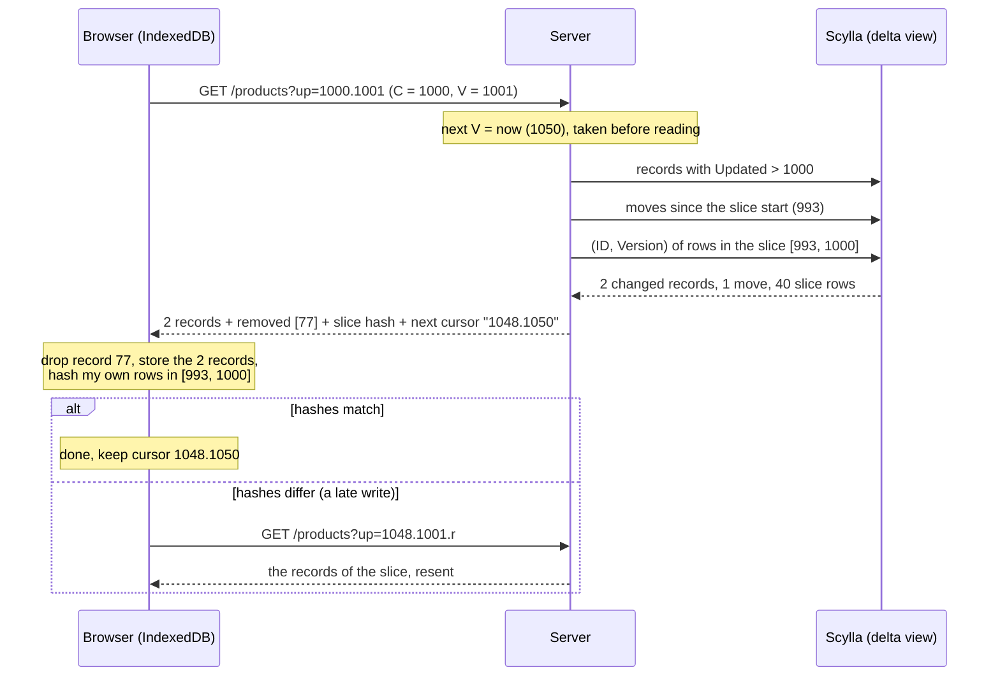
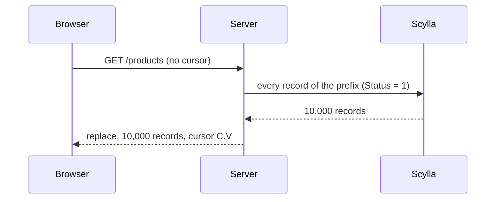
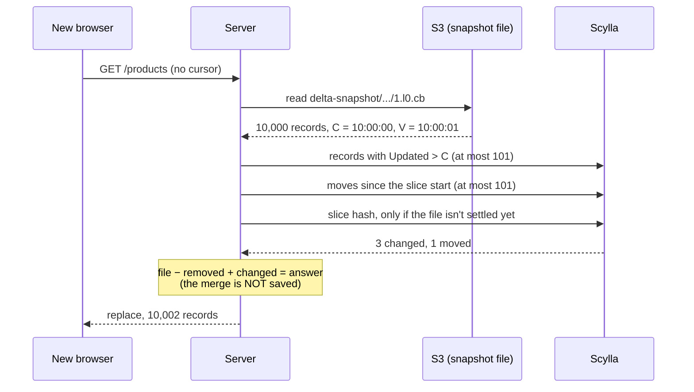

# The delta cache, explained

How a browser keeps a list (products, clients, sale orders…) up to date without downloading the
whole list on every page load. Written for people, not for the compiler. The precise
specification lives in the code: `delta_window.go` and `delta_snapshot.go` (this folder) and
genix-ui's `cache/DELTA_CACHE.md`.

---

## 1. The idea in one paragraph

The browser stores the records it has already received (in IndexedDB). On each sync it tells the
server **how far it got**, and the server answers **only what changed since then**. The first time
there is nothing stored, so the server sends everything: that is a **replace**. After that, a sync
usually returns zero, one, or a handful of records.

```
 First visit                          Every visit after
 ───────────                          ─────────────────
 browser: "I have nothing"            browser: "I got up to 10:00:00"
 server:  10,000 records (replace)    server:  the 3 records changed since then
```

---

## 2. Words used below

| Word | Meaning |
|---|---|
| `Updated` (`upd`) | Every record carries the time of its last write, in 2-second ticks (SUnixTime). |
| `Version` (`ver`) | A counter that goes up on every write of a record. |
| **C** | The highest `Updated` among the records the browser holds: "how far I got". |
| **V** | The server's clock when it started answering the browser's last sync. |
| **Cursor** | What the browser sends: `C.V`, for example `400000000.400000001`. |
| **Prefix** | One slice of the table the sync covers, for example "products with Status = 1". A sync can cover several. |
| **Replace** | An answer with *all* the records of the prefixes: the browser throws away what it held for them. |
| **Moves** | Records that *left* a prefix (soft-deleted, status changed, moved to another warehouse). They come back as "removed IDs". |
| **Snapshot** | A copy of a replace answer that the server keeps in the file store (S3). Section 7. |

---

## 3. Why the simple version isn't enough: late writes

The obvious approach is "send me everything with `Updated > C`". It fails because **a write is
stamped before it is visible**. The server stamps `Updated` when the write starts, and the record
only shows up in the listing a moment later (network, database replication, the materialized view
catching up).

```
time ──────────────────────────────────────────────────────────────►
            10:00:00            10:00:01                10:00:06
               │                   │                       │
 write A:  stamped 10:00:00 ...........................  visible
                                   │
 browser:                     syncs, gets C = 10:00:00
                              (A is not visible yet, so it isn't in the answer)

 next sync: "Updated > 10:00:00"  →  A (stamped 10:00:00) is NOT > C  →  missed forever
```

The protocol assumes a write becomes visible **at most 16 seconds** after its stamp
(`DeltaWriteLagTicks`). That is where **V** comes in.

---

## 4. The unsettled slice

If the server started reading at time V, every write stamped **before V − 16 s** was already
visible to that read. So the only records the browser can have missed are those stamped between
**V − 16 s** and **C**: the *unsettled slice*.

```
                       unsettled slice
                    ┌─────────────────┐
 ───────────────────┼─────────────────┼──────────┼──────────►  time
               V − 16 s               C          V
   settled: the browser           may hold     server started
   has all of it                  late writes  reading here
```

For that slice the server does **not resend the records**. It sends a **hash** of them: one
number computed from the `(ID, Version)` of every record in it. The browser computes the same
hash over what it holds. Equal hashes mean nothing was missed.

Once the browser syncs again more than 16 s after C (V − 16 s > C), the slice is empty and there is
nothing to hash: the sync is one read of `Updated > C`, normally empty.

---

## 5. A normal sync, step by step



What the browser does with an answer:

1. Removes the **removed IDs**.
2. Stores the **records** (a record with the same `Version` as the held one is skipped).
3. Hashes the records it holds inside the slice, **leaving out** the ones this answer just
   brought or removed (their held copy is being replaced anyway).
4. Compares with the server's hash.
   - **Match**: keeps `C.V` from the answer.
   - **Mismatch**: keeps the new C with its **old V** plus `.r` and syncs again at once. The `.r`
     makes the server resend the slice's records instead of hashing them. The old V is kept on
     purpose: the slice that missed a write is the old one.

---

## 6. Worked example: importing 10,000 products

At 10:00:00 an Excel import writes 10,000 products. They all get the same `Updated` tick.

| Time | What the browser sends | What the server does | Sent to the browser |
|---|---|---|---|
| 10:00:01 | `C.V` from yesterday | 10,000 changed > 100 (threshold) | **replace**: 10,000 products, cursor `C=10:00:00, V=10:00:01` |
| 10:00:03 (page reload) | `10:00:00.10:00:01` | `Updated > C`: nothing. Slice `[09:59:45, 10:00:00]`: hashes the 10,000 slim rows | **0 records**, one hash. Browser hash matches. |
| 10:05:00 | `10:00:00.10:00:03` (V of the last answer) | slice `[09:59:47, 10:00:00]` still holds C: hashes once more | 0 records, one hash; the new V is 10:05:00 |
| every sync after | `10:00:00.10:05:00` | 10:05:00 − 16 s > C: the slice is empty, one read of `Updated > C` | **0 records, no hash** |

The 10,000 products travel **once**. Before this design, every sync resent them.

### The same import, with one product edited right after

At 10:00:05 someone fixes product #42. The browser reloads at 10:00:08.

- The server sends #42 (its `Updated` is now 10:00:05, > C).
- The slice hash covers 9,999 products: #42 left the slice on the server.
- The browser hashes its slice **without #42**, because the answer just brought it: 9,999 products.
  Hashes match. One record sent.

### A real late write

Product #5001 was stamped 09:59:58 but only became visible at 10:00:02, after the browser's sync at
10:00:01.

- The reload at 10:00:03 gets the slice hash. The server's includes #5001's new version, the
  browser's has the old one: **mismatch**.
- The browser asks again with `.r`, and the server resends the slice. Here that is the 10,000
  products, since they share the tick. This only happens on a real late write.

---

## 7. Replaces, with and without the S3 snapshot

A **replace** happens on a first sync (no cursor) or when more than 100 records changed or moved
since the cursor (`DeltaReplaceThreshold`). A replace must send every record of the prefix, and
there are two ways to get them.

### Without a snapshot: read the database



Simple and always correct, but **every new browser costs a full read** of the prefix from Scylla.
This is the path whenever:

- no file store is installed (genix always installs one: `core.ConfigureFileStore`, the backend
  doesn't boot without `[file_store].bucket`);
- the query has a `Select` projection (the file holds whole records);
- the record type has a stored column colbin can't encode (`cb:"-"`);
- S3 doesn't answer (the server falls back to the database and writes nothing).

### With a snapshot: S3 file + only what changed since it

The first replace reads the database **and saves the answer** as a file:

```
s3://<bucket>/<root>/delta-snapshot/products/<company>/status/1.l0.cb
                                      table    partition  index  prefix  limit
```

The file holds the records plus the same **C** and **V** a browser would hold. The next replace,
from any browser and any user, starts from the file and checks it **exactly the way a browser
checks its own records**:



So instead of reading 10,000 records from Scylla, the server reads one S3 file plus a few rows.

### When the file is not used

The server reads the database instead, and that full read **rewrites** the file, when:

| Reason | Why |
|---|---|
| No file yet | Nothing to start from. |
| The record struct changed | The file names the colbin schema it was written with. |
| More than 100 changes or moves since its C | Cheaper to read the database than to patch. |
| The slice hash doesn't match | A late write the file doesn't have. |
| A `Limit` cut the file and a removal opened a gap | The older records needed to fill it aren't in the file. |
| **The file is more than 2 hours old** (past its V) | See below. |

### Why the snapshot rules are strict

- **Only a database read writes a file.** A merged answer is served and thrown away. If merges were
  saved, a missed write would be copied into every future snapshot.
- **At most 2 hours old** (`RecordSnapshotMaxAgeTicks`). Once a file is more than 16 s past its C,
  nothing checks it again. If a write ever broke the 16-second rule, it would be missing from every
  new browser's first sync until 100 changes forced a rewrite, which on a quiet table could take
  weeks. The 2-hour limit caps that.
- **Two requests can't overwrite each other.** A file is written only if it is still the one the
  request read (`PutFileIfMatch` on its ETag).

### Side by side

| | Without snapshot | With snapshot |
|---|---|---|
| First sync of a 10,000-record prefix | 10,000 rows read from Scylla | 1 S3 file + ≤ 101 changed rows + ≤ 101 moves |
| Cost per new browser | Full read every time | Full read at most once per 2 h, or after 100 changes |
| Normal syncs (with a cursor) | Same in both: the snapshot is only for replaces | |
| Storage | None | One file per prefix in the file store |

---

## 8. Endpoints that return several tables

Some endpoints answer several lists at once:
`{ Sales: [...], Expenses: [...], PurchaseOrders: [...] }`. Each list is synced on its own:

- **Its own cursor**, one query parameter per list:
  `GET /accounting-operations?Sales=950.1001&Expenses=1000.1001&...`
  (a plain-array endpoint uses the parameter `up`).
- **Its own answer**: each list ends with its own Metadata record (next cursor, slice hash,
  removed IDs).
- **Its own mismatch**: if only `Sales` mismatches, only `Sales` gets `.r`. The retry still sends
  every list's cursor, because the handler runs all its queries and a list without a cursor would
  be a full replace. The lists that matched are settled by then, so their reads are empty.

---

## 9. What each side stores

```
 Browser (IndexedDB), per route
 ├─ records of each list
 └─ deltaCursors: { Sales: "950.1001", Expenses: "1000.1001.r", ... }

 Server, nothing per browser. Per table:
 ├─ the base table
 ├─ one materialized view per TypeDelta index, ordered by [keys…][Updated]
 ├─ <table>__delta_moves: which IDs left which prefix, and when
 └─ (S3) delta-snapshot/<table>/<partition>/<index>/<prefix>.l<limit>.cb
```

---

## 10. Limits to know

- **The 16-second rule is trusted.** A write that becomes visible more than 16 s after its stamp is
  missed by browsers already past it, until that record is written again. Snapshots carry such a
  miss for at most 2 hours.
- **A late write resends the whole slice.** Records sharing the tick of a bulk write all come again.
  This is rare.
- **Bulk status changes are re-checked for 16 s.** Moves are read from the slice start, so a reload
  within 16 s of soft-deleting more than 100 records answers a replace.
- **Replace threshold: 100** changed or moved records per sync, per table
  (`Index.DeltaReplaceThreshold`).

---

## 11. Constants

| Constant | Value | Where |
|---|---|---|
| `DeltaWriteLagTicks` | 8 ticks = 16 s | `delta_window.go` |
| `DefaultDeltaReplaceThreshold` | 100 records | `delta_window.go` |
| `RecordSnapshotMaxAgeTicks` | 3600 ticks = 2 h | `record_snapshot.go` |
| Tick | 2 seconds (SUnixTime) | project convention |
